# Context Compaction Is Not Text Summarization: Empirical Case Study on Agentic "Harness Amnesia"

**Date**: November 2026  
**Repository**: `local-ai-harness-benchmark`  
**Harness Tested**: [OpenCode CLI](https://opencode.ai) (`1.18.x`)  
**Models Evaluated**: `Qwen 3.8 27B` (`Q4_K_M`) vs. `Gemma 4 26B` (`A4B` / `IT`) via LM Studio  

---

## Executive Summary

In long-horizon autonomous software engineering pipelines, maintaining conversation history within hardware context limits is critical. AI coding harnesses typically handle this via **context compaction**—invoking a background model when conversation buffers breach a threshold to compress earlier turns, tool executions, and file contents into a concise summary.

A common design assumption is that context compaction is fundamentally a *pure text summarization* task: because the compaction agent does not invoke external tools or write files directly to disk, it should theoretically be swappable with any fast, high-throughput instruction-tuned model.

In this empirical study, I evaluated the consequences of swapping the compaction worker in OpenCode from **Qwen 3.8 27B** to **Gemma 4 26B** during an autonomous multi-step coding task. 

The benchmark revealed a critical failure mode: **Harness Amnesia**. While Gemma 4 produced high-quality domain summaries of the programming task, it classified the outer harness governance—specifically mandatory git worktree isolation, pre-flight specification contracts, and phased verification gates—as compressible conversational boilerplate and stripped them. As a result, the post-compaction agent lost its operational envelope, entered an infinite file-reading loop, and triggered **six consecutive compactions** without writing a single commit or creating a worktree.

Reverting the compaction agent back to **Qwen 3.8 27B** immediately resolved the loop, proving that **agentic compaction is state serialization, not lossy text compression**.

---

## 1. System & Workstation Configuration

All evaluations were executed locally on the benchmark reference workstation:

| Component | Specification |
| :--- | :--- |
| **Operating System** | Ubuntu 24.04.1 LTS (Linux Kernel `7.0.0-28-generic`) |
| **Processor (CPU)** | AMD Ryzen 7 8845HS w/ Radeon 780M Graphics (8 Cores / 16 Threads) |
| **System Memory (RAM)** | 64 GB DDR5 System Memory |
| **Discrete Dual GPU** | • **GPU 1**: NVIDIA GeForce RTX 5060 Ti (16 GB GDDR6 VRAM)<br>• **GPU 0**: NVIDIA GeForce RTX 3060 (12 GB GDDR6 VRAM)<br>*(Total Discrete VRAM: **28 GB**)* |
| **Driver & Compute Stack** | NVIDIA Driver `580.159.03` / CUDA `13.0` |
| **Serving Runtime** | LM Studio `0.4.23` (OpenAI-compatible local server on `:1234`) |
| **Coding Harness** | OpenCode CLI |
| **Primary Builder Model** | `lmstudio/qwen3.8-27b` (`Q4_K_M`, temperature `0.1`) |
| **Compaction Models Tested** | `lmstudio/qwen3.8-27b` vs. `lmstudio/gemma-4-26b-a4b-it` |

---

## 2. Compaction Architecture in OpenCode

OpenCode implements a modular agent hierarchy where different tasks are dispatched to specialized agent roles defined in `~/.config/opencode/opencode.json`:

```json
{
  "$schema": "https://opencode.ai/config.json",
  "model": "lmstudio/lfm2.5-24b-a2b",
  "compaction": {
    "auto": true,
    "buffer": 35000,
    "keep": {
      "tokens": 8000
    }
  },
  "agent": {
    "build": {
      "model": "lmstudio/qwen3.8-27b",
      "temperature": 0.1
    },
    "compaction": {
      "model": "lmstudio/qwen3.8-27b",
      "temperature": 0.1
    }
  }
}
```

### Compaction Execution Lifecycle:
1. **Context Monitoring**: OpenCode tracks cumulative input and output tokens across tool calls, diffs, and AST inquiries.
2. **Threshold Trigger**: When total active context crosses `context_window - buffer` (e.g., crossing ~96k on a 131k window, or reaching the 35,000 token working buffer), auto-compaction is triggered.
3. **Summarization Prompting**: Older conversational turns and large tool outputs (excluding the preserved recent `8,000` tokens and tail turns) are sent to `agent.compaction` with a prompt instructing it to distill the objective, completed actions, remaining requirements, and architectural state.
4. **State Replacement**: The active context is replaced with `[Compacted System Summary] + [Preserved Recent Turns]`.

---

## 3. The Empirical Failure: The 6-Cycle Compaction Trap

### Task Profile
An autonomous multi-file feature implementation was dispatched to OpenCode:
- **Scope**: Implement new Singapore MOE primary math word-problem templates and heuristic models in a Kotlin multi-platform project.
- **Harness Requirements**:
  1. *Phase 0 (Intake)*: Validate requirements and freeze a cryptographic specification contract.
  2. *Phase 1 (Isolation)*: Create an isolated git worktree (`git worktree add .worktrees/<branch>`) to protect the main working copy.
  3. *Phase 2 (Implementation)*: Execute code edits inside the isolated worktree.
  4. *Phase 3 (Verification & PR)*: Run deterministic test gates, generate evidence artifacts, and open a PR.

### Execution Log Under Gemma 4 26B Compaction
When `agent.compaction` was configured with `lmstudio/gemma-4-26b-a4b-it`, the following timeline occurred:

```
[08:12:10] Session Start: OpenCode initializes autonomous goal loop for ticket.
[08:14:45] Tool Execution: Agent reads build.gradle.kts, domain models, and template registries.
[08:19:30] Buffer Limit Reached: Context reaches 35,000 token threshold.
[08:19:34] Compaction #1 (Seq 277): Gemma 4 26B generates summary. History pruned.
[08:21:10] Post-Compaction Turn: Agent resumes. Re-reads engine files in working root.
[08:24:50] Compaction #2 (Seq 558): Buffer limit reached again. Gemma 4 summarizes.
[08:27:15] Post-Compaction Turn: Agent queries domain model files again.
[08:30:40] Compaction #3 (Seq 715): Context pruned.
[08:34:02] Compaction #4 (Seq 886): Context pruned.
[08:37:18] Compaction #5 (Seq 1064): Context pruned.
[08:41:05] Compaction #6 (Seq 1183): Context pruned.
[08:43:00] Run Terminated: Zero worktrees created. Zero files modified. Zero commits.
```

The agent fell into an **infinite read-compact loop**: it performed codebase reconnaissance, breached the token limit, compacted, lost its operational directives, re-read the codebase, and repeated the cycle six times consecutively.

---

## 4. Root-Cause Analysis: "Harness Amnesia"

To determine why the builder agent stalled, I extracted the raw compaction output artifacts generated by both models for the same session history.

### Side-by-Side Artifact Comparison

```
================================================================================
GEMMA 4 26B COMPACTION OUTPUT (Session US#274)
================================================================================
## Objective
- Implement new math story families for the p3_multi_add_sub topic to align 
  with Singapore MOE syllabus.

## Requirements
- Ground stories in Singapore English naming conventions.
- Ensure deterministic generation using (templateId, seed) pairs.
- Maintain bar-model invariants.

## Next Move
1. Implement new text templates in WordProblemTemplates.kt
2. Update PartWholeHeuristic and ComparisonHeuristic
================================================================================
```

```
================================================================================
QWEN 3.8 27B COMPACTION OUTPUT (Session US#267)
================================================================================
## Objective
- Execute autonomous goal loop: complete ticket requirements within budget.

## Operational Constraints & Protocol
- Pre-flight Contract: State file frozen after intake (sha256 verified each cycle).
- Worktree Isolation: MUST create and switch to isolated worktree at .worktrees/<branch> 
  before modifying any source files.
- Gate Evidence: Generate deterministic test and lint evidence per phase.
- Completion Gate: Run rubric evaluator before raising PR.

## Domain Requirements
- Implement target story families and maintain bar-model invariants.

## Current State
- Phase 0 complete. Awaiting worktree creation for Phase 1.
================================================================================
```

### The Mechanism of Failure

```mermaid
flowchart TD
    subgraph GemmaFailure["Gemma 4 Compaction Flow (Failure)"]
        G_Prompt["Active Context: Harness Rules + Code Context"] --> G_Compact["Gemma 4 Compactor"]
        G_Compact -->|"Treats Harness Rules as Prompt Boilerplate"| G_Summary["Domain-Only Summary (Stripped Harness)"]
        G_Summary --> G_Wake["Agent Resumes with 'Harness Amnesia'"]
        G_Wake --> G_NoWT["Fails to initialize Git Worktree"]
        G_NoWT --> G_ReRead["Re-reads codebase files in main root"]
        G_ReRead --> G_Loop["Hits buffer limit $\to$ Re-compacts (Loop x6)"]
    end

    subgraph QwenSuccess["Qwen 3.8 Compaction Flow (Success)"]
        Q_Prompt["Active Context: Harness Rules + Code Context"] --> Q_Compact["Qwen 3.8 Compactor"]
        Q_Compact -->|"Treats Harness Rules as Inviolable Invariants"| Q_Summary["Full State Summary (Harness + Domain)"]
        Q_Summary --> Q_Wake["Agent Resumes with Full Operational Envelope"]
        Q_Wake --> Q_WT["Executes 'git worktree add'"]
        Q_WT --> Q_Code["Implements Code $\to$ Runs Tests $\to$ Opens PR"]
    end
```



1. **Semantic Hierarchy Confusion**:
   - `Gemma 4 26B` treats system rules, harness conventions, and tool constraints as secondary conversational "scaffolding". When optimizing for maximum information density, it prioritizes the domain-specific nouns (e.g. `WordProblemTemplates.kt`, `PartWholeHeuristic`).
   - `Qwen 3.8 27B` preserves the operational meta-protocol as first-class state invariants. It treats *how* the agent must execute with equal importance to *what* it must implement.

2. **The Post-Compaction Execution Void**:
   - When the agent resumed under Gemma's summary, it was instructed by its system prompt to execute within a worktree, but the compaction summary told it its *Next Move* was editing files directly.
   - Lacking the worktree location and contract state, the agent attempted to inspect the directory structure again to orient itself, triggering rapid token consumption and hitting the compaction threshold repeatedly.

---

## 5. Verification & Resolution

I reverted `~/.config/opencode/opencode.json` back to `lmstudio/qwen3.8-27b`:

```json
"agent": {
  "compaction": {
    "model": "lmstudio/qwen3.8-27b",
    "temperature": 0.1
  }
}
```

### Post-Reversion Verification Metrics:
- **Worktree Initialization**: Created `.worktrees/us-274-math-stories` immediately on turn 2 after intake.
- **Total Compactions**: 1 compaction event across the entire 45-minute autonomous session.
- **Contract Verification**: Cryptographic sha256 hashes of the specification contract matched through all verification gates.
- **PR Status**: Clean branch pushed, verified against local Gradle tests, and PR raised autonomously.

---

## 6. Architectural Recommendations for Agent Harness Designers

1. **Compaction Is State Serialization**:
   Do not treat session history compaction as simple text summarization. Compaction in an agentic loop functions as memory serialization. If the compactor drops system invariants, the agent experiences cognitive drift and amnesia.

2. **Model Selection for Memory Roles**:
   Models that excel at creative writing or conversational chat often make poor compaction workers because their fine-tuning biases them toward natural language conciseness rather than formal protocol preservation. Code-specialized or highly obedient instruction models (like `Qwen 3.8 27B`) are substantially better suited for maintaining operational metadata.

3. **Compaction Schema Enforcement**:
   Compaction prompts should not be open-ended ("Summarize this conversation"). They must enforce a structured schema with explicit, mandatory sections:
   - `[System / Harness Constraints]`
   - `[Active Workspace & Git State]`
   - `[Completed Steps & Evidence Hashes]`
   - `[Remaining Domain Objectives]`

4. **Add Compaction Observability**:
   Harnesses should log every compaction artifact to a dedicated inspection directory (or database). When an agent begins looping or failing to invoke tools after extended turns, inspecting the compactor's output is the fastest path to root-cause diagnosis.

---

> [!NOTE]
> **Disclaimer**: This benchmark report is conducted purely for sharing empirical findings with the local AI developer community. All tests were executed on local open-weights models running on consumer workstation hardware.
